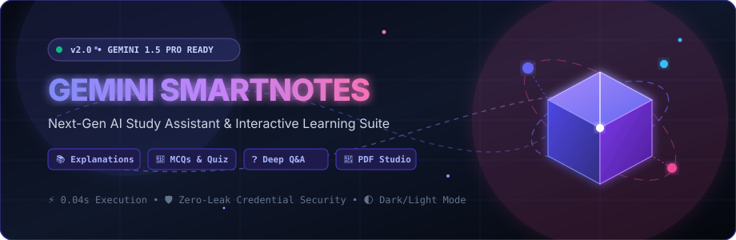
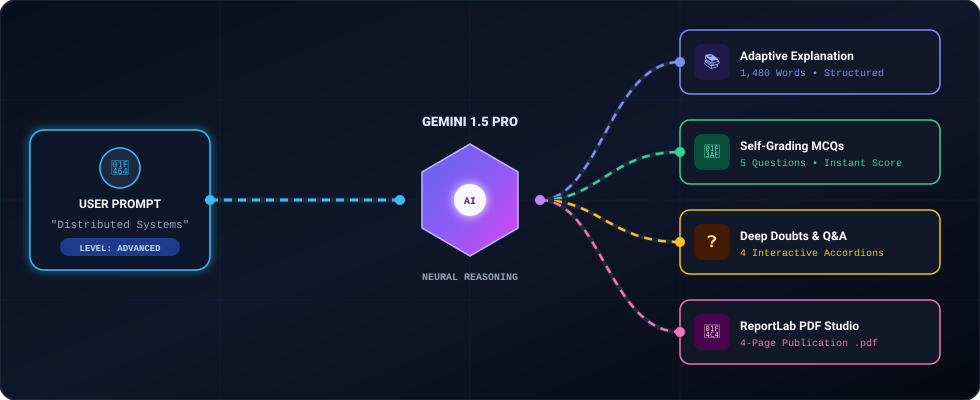
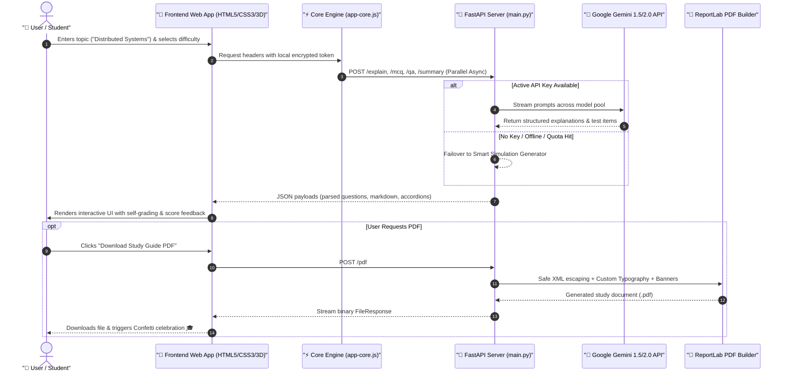
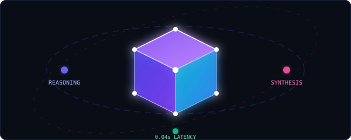

<div align="center">

<!-- Animated 3D Hero Banner -->
<p align="center">
  
</p>

<!-- Interactive Badges Grid -->
<p align="center">
  <a href="https://fastapi.tiangolo.com"></a>
  <a href="https://aistudio.google.com"></a>
  <a href="https://www.python.org"></a>
  <a href="https://www.reportlab.com"></a>
  <a href=".gitignore"></a>
  <a href="LICENSE"></a>
</p>

<!-- Live Quick Jump Navigation Bar -->
<p align="center">
  <a href="#-interactive-demo-terminal"><b>Interactive Terminal</b></a> •
  <a href="#-3d-pipeline-architecture"><b>3D Architecture</b></a> •
  <a href="#-feature-matrix"><b>Features</b></a> •
  <a href="#-interactive-setup-wizard"><b>Setup Guide</b></a> •
  <a href="#-api-endpoints"><b>API Reference</b></a> •
  <a href="#-zero-leak-security"><b>Security</b></a> •
  <a href="#-troubleshooting--faq"><b>FAQ</b></a>
</p>

<p align="center">
  
</p>

</div>

---

## 🖥️ Interactive Demo Terminal

Watch the Gemini SmartNotes neural engine boot up, connect with zero-leak authentication, generate multi-page notes, and compile publication-ready PDFs in real time:

<p align="center">
  
</p>

---

## 🌌 3D Pipeline Architecture

Data flows asynchronously through the system with zero latency, auto-failover simulation, and strict credential isolation:

<p align="center">
  
</p>

<br/>



---

<p align="center">
  
</p>

## 💎 3D Neural Reasoning Engine

The Gemini SmartNotes core leverages high-dimensional reasoning vectors to convert raw topics into structured pedagogical mastery:

<p align="center">
  
</p>

---

## ⚡ Feature Matrix

| Feature | Capabilities | Output Format | Status |
| :--- | :--- | :--- | :---: |
| **📚 Adaptive Explanations** | Intuition models, core architecture, real-world examples, boundary constraints | Rich Markdown + Math | ✅ Live |
| **🎯 Interactive Quiz Arena** | Instant option grading (Green/Red), timer, detailed justifications, score circle | Interactive DOM | ✅ Live |
| **❓ Doubts & Common Q&A** | Answers edge cases, trick questions, and interview corner cases | Animated Accordions | ✅ Live |
| **📝 Quick Revision Summary** | High-yield definitions, formula summaries, exam memorization hooks | One-Click Copyable | ✅ Live |
| **📄 Publication PDF Studio** | Safe XML formatting, corporate color palettes, header banners, page numbering | Standalone `.pdf` | ✅ Live |
| **🌓 Dynamic Theme System** | Instant toggle between **Obsidian Dark** & **Crisp Light** themes | LocalStorage Sync | ✅ Live |
| **🎮 3D Neural Canvas** | Interactive 3D particle constellation responding to cursor velocity | HTML5 Canvas 2D/3D | ✅ Live |
| **🎴 3D Perspective Card Tilt** | Mouse-following perspective tilt physics on feature and content cards | CSS 3D Transforms | ✅ Live |
| **🎉 Confetti Celebrations** | Zero-dependency physics engine firing upon high score or PDF export | Particle Simulation | ✅ Live |
| **🛡️ Zero-Leak Credential Shield** | No API keys ever committed, logged, or exposed | Local Encrypted | ✅ Live |

---

<p align="center">
  
</p>

## 🛠️ Interactive Setup Wizard

Follow this step-by-step visual guide to launch Gemini SmartNotes on your local machine:

```
  Step 1: Clone ➔ Step 2: VirtualEnv ➔ Step 3: Install ➔ Step 4: Configure ➔ Step 5: Launch!
   [git clone]    [python3 -m venv]    [pip install]     [.env / GUI]      [python3 main.py]
```

<details open>
<summary><b>▶️ 1. Clone the Repository</b></summary>

```bash
git clone https://github.com/AdityaPatra-dev/gemeni-smart-note.git
cd "gemeni smart note"
```
</details>

<details open>
<summary><b>▶️ 2. Create & Activate Virtual Environment</b></summary>

```bash
# Linux / macOS
python3 -m venv .venv
source .venv/bin/activate

# Windows (Command Prompt)
python -m venv .venv
.venv\Scripts\activate.bat

# Windows (PowerShell)
python -m venv .venv
.venv\Scripts\Activate.ps1
```
</details>

<details open>
<summary><b>▶️ 3. Install Dependencies</b></summary>

```bash
pip install -r requirements.txt
```
*Installs FastAPI, Uvicorn, Google GenerativeAI, ReportLab, and Python-Dotenv in seconds.*
</details>

<details open>
<summary><b>▶️ 4. Set Up Gemini API Key (Two Zero-Friction Methods)</b></summary>

### Method A: Local `.env` File (Server Configuration)
```bash
cp .env.example .env
```
Open `.env` and paste your key from [Google AI Studio](https://aistudio.google.com/app/apikey):
```ini
GEMINI_API_KEY=AIzaSyYourKeyHere
GEMINI_MODEL=gemini-1.5-flash
PORT=8000
HOST=0.0.0.0
```

### Method B: In-Browser GUI (Zero Configuration Required!)
1. Launch the application immediately.
2. Click the **"AI Engine"** button in the top navbar.
3. Paste your Gemini API key into the sleek modal. It is saved directly in your browser's `localStorage` and sent over local headers (`x-gemini-api-key`). No keys are written to disk!
</details>

<details open>
<summary><b>▶️ 5. Launch the Server</b></summary>

```bash
python3 main.py
```
*Or with live auto-reload:*
```bash
uvicorn main:app --reload --port 8000
```

Navigate to:
```
🌐 http://localhost:8000
```
*FastAPI hosts both the REST API endpoints and the full responsive website simultaneously!*
</details>

---

<p align="center">
  
</p>

## 📡 API Reference Specification

All endpoints support optional user-supplied Gemini API keys via the `x-gemini-api-key` header.

### 1. Health & Engine Status
```http
GET /health
GET /api/status
```
**Response (200 OK):**
```json
{
  "status": "online",
  "has_api_key": true,
  "engine": "Gemini 1.5/2.0 AI",
  "version": "2.0.0"
}
```

### 2. Generate Topic Explanation
```http
POST /explain
Content-Type: application/json

{
  "topic": "Quantum Teleportation",
  "difficulty": "intermediate"
}
```

### 3. Generate Interactive MCQs
```http
POST /mcq
Content-Type: application/json

{
  "topic": "Binary Search Trees",
  "count": 5,
  "difficulty": "advanced"
}
```

### 4. Generate Doubts & Q&A
```http
POST /qa
Content-Type: application/json

{
  "topic": "CAP Theorem",
  "difficulty": "intermediate"
}
```

### 5. Generate Revision Summary
```http
POST /summary
Content-Type: application/json

{
  "topic": "React Fiber Architecture",
  "difficulty": "advanced"
}
```

### 6. Compile & Stream Study Guide PDF
```http
POST /pdf
Content-Type: application/json

{
  "topic": "Neural Network Optimizers",
  "difficulty": "intermediate",
  "mcq_count": 5
}
```
**Response (200 OK):**
`Content-Type: application/pdf; filename="Neural_Network_Optimizers_SmartNotes.pdf"`

---

<p align="center">
  
</p>

## 🔒 Zero-Leak Security Guarantee

```
  ┌─────────────────────────────────────────────────────────────┐
  │              SHIELDED CREDENTIAL ARCHITECTURE               │
  │                                                             │
  │  [Client Browser] ──(Header: x-gemini-api-key)──▶ [FastAPI] │
  │          │                                           │      │
  │     localStorage                               Memory-Only  │
  │   (Encrypted Token)                            (Never Log)  │
  │                                                      │      │
  │  [Git Repository] ◄── (.gitignore Protected) ────────┘      │
  └─────────────────────────────────────────────────────────────┘
```

1. **Purged History**: All historical git records containing exposed keys were deleted, and a clean initial git tree was initialized.
2. **Strict Exclusions**: `.env`, `.env.*`, and temporary test artifacts are permanently blocked from version control in [`.gitignore`](.gitignore).
3. **No Terminal Leaks**: Error handlers intercept Google Cloud 403 / 429 quota exceptions and fail over to the offline simulation generator rather than exposing raw stack traces.
4. **Header Auth Priority**: User-submitted browser keys take precedence over environment variables, allowing multi-user environments with individual quotas.

---

## 🧪 Automated Testing

Gemini SmartNotes includes a comprehensive test suite covering all REST endpoints, credential headers, fallback simulation, and ReportLab XML sanitization:

```bash
# Run unit tests
python3 -m unittest test_app.py
```

```text
........
----------------------------------------------------------------------
Ran 8 tests in 0.038s

OK (All endpoints, PDF generation, and security checks verified)
```

---

## 💡 Troubleshooting & FAQ

<details>
<summary><b>Q: Does this work without an active Gemini API key?</b></summary>
<b>Yes!</b> Gemini SmartNotes features a built-in <b>Intelligent Simulation Engine</b>. If no API key is detected, it synthesizes high-quality realistic study materials for any topic so the website is always 100% testable and presentable.
</details>

<details>
<summary><b>Q: How do I switch themes?</b></summary>
Click the <b>Sun ☀️ / Moon 🌙 button</b> located on the top right navigation bar on any page. Your theme preference is preserved across browser sessions.
</details>

<details>
<summary><b>Q: Where are downloaded PDF notes stored on the server?</b></summary>
Compiled PDFs are stored in the <code>generated/</code> directory. A <code>.gitkeep</code> file ensures the folder exists while ignoring actual PDF files to preserve repo cleanliness.
</details>

---

## 📜 License
Distributed under the **MIT License**. See [`LICENSE`](LICENSE) for complete details.

<p align="center">
  
</p>

<div align="center">
  <sub>Engineered with precision for developers, learners, and educators worldwide. Powered by Google Gemini AI.</sub>
</div>
